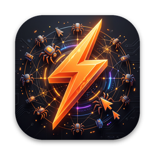
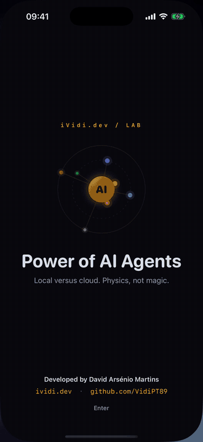

<p align="center">
  
</p>

# ⚡ Power of AI Agents

> Native iOS & macOS app that shows, in real time, why small local AI models can outpace cloud APIs, and how a swarm of parallel agents builds an interface layer by layer. Built with SwiftUI.

[Report Bug](https://github.com/VidiPT89/PowerOfAIAgents/issues) · [Request Feature](https://github.com/VidiPT89/PowerOfAIAgents/issues)

<p align="center">
  
</p>

## ✨ Features

- ✅ **Agent race:** four robotic spider agents crawl the same article and decide, link by link, whether each link is about spiders. Two run locally, two in the cloud. They all walk at the same speed, so the only difference is how long each one needs to decide
- ✅ Live verdict boxes on the page: green for correct finds, red for false alarms, dashed for missed links
- ✅ Cloud agents show the request travelling to the data centre and back (TCP · TLS, server queue, inference, response)
- ✅ Live scoreboard with finds, decisions and average latency per decision, plus a final "× more decisions" summary
- ✅ **Share:** when a race ends, share the scoreboard as an image with the app logo, ready for social media
- ✅ **Agent lab:** tune each agent's type (local or cloud), inference time, network round trip, queue and accuracy, with a live estimate of decisions per race, plus one-tap network presets (same city, fibre, 4G, satellite, or your measured connection). Settings are saved and also drive the latency and cascade screen
- ✅ **Real measurement:** real HTTPS requests to ividi.dev split into DNS, TCP, TLS, round trip and transfer (first versus follow-up request, with actual connection reuse reported), an on-device word-embedding encoder (NaturalLanguage) and, on devices with Apple Intelligence, Apple's on-device generative model (Foundation Models) labelling the same 12 English terms. The results can be shared as an image and applied to the race
- ✅ **Agent swarm:** from 1 to 32 cursors take layers from a shared queue and build a review dashboard on a canvas, with size badges and a live "agents · layers" status pill
- ✅ Exact expected build time and speed-up compared with a single agent (the swarm is deterministic, so the result is known before it starts)
- ✅ **Latency anatomy:** stacked bars showing where every millisecond goes (TCP, TLS, routing, queue, inference) for each agent
- ✅ **Cascade simulator:** choose how much traffic a local model escalates to the cloud and see the resulting average latency
- ✅ Deterministic, seedable simulation engine, separated from the UI and covered by unit tests run on every push (GitHub Actions)
- ✅ Simulations pause when the app goes to the background, and a frame never advances more than 0.1 s, so nothing jumps ahead after a hitch
- ✅ Privacy manifest included: no tracking or analytics. The only network access is the optional measurement, which sends HEAD requests to ividi.dev when you tap **Measure**. The server receives the IP address and standard connection metadata, but no article text
- ✅ Animated splash screen with the app logo and credits
- ✅ Runtime language switch: Português (PT-PT) and English
- ✅ Dark mode, Light mode and System mode
- ✅ Custom colour identity inspired by [ividi.dev](https://ividi.dev/): orange, burnt amber and near-black
- ✅ One shared SwiftUI codebase for iPhone, iPad and Mac

> **Note:** the race, swarm and latency screens are illustrative simulations. The agent names (Ember, Nimbus, Stratus, Flint) are fictional, and the latencies use realistic orders of magnitude for on-device inference, network round trips, TLS, server queues and token-by-token generation. The **Measure** tab is the exception: everything there is measured for real on your device.

## 🛠️ Tech Stack

| Category | Technology |
|----------|------------|
| Language | Swift 6 |
| UI | SwiftUI, Canvas (iOS 17+ / macOS 14+) |
| Text layout | Core Text |
| Real measurement | URLSession task metrics, NaturalLanguage word embeddings, Apple Foundation Models (iOS 26 / macOS 26) |
| Testing | XCTest |
| Project | XcodeGen |

## 🚀 Quick Start

**Prerequisites**
- Xcode 16+
- [XcodeGen](https://github.com/yonaskolb/XcodeGen) (only needed to regenerate the project)
- iOS 17+ simulator or device, or a Mac running macOS 14+

**Steps**

1. Clone the repository

```bash
git clone https://github.com/VidiPT89/PowerOfAIAgents.git
cd PowerOfAIAgents
```

2. (Optional) Regenerate the Xcode project

```bash
xcodegen generate
```

3. Open the project and run

```bash
open PowerOfAIAgents.xcodeproj
```

Choose the `PowerOfAIAgents` scheme for iPhone/iPad or `PowerOfAIAgents-macOS` for the Mac.

## 📖 Usage

- **Race:** press **Start race** (or Space on the Mac). Pick a duration of 10, 20, 30 or 60 seconds. **Reset** starts a new run with a fresh seed.
- **Tune:** open the agent lab to change each agent. Try moving a cloud agent onto the device, or making the local encoder less accurate, and run the race again. An orange dot on **Tune** means custom values are active; **Restore all defaults** brings back the original line-up.
- **Swarm:** choose the number of agents with the slider and press **Build**. Compare the elapsed time with the single-agent time.
- **Measure:** tap **Measure** to time real requests to ividi.dev and the on-device models. **Use in the race** copies measured model times and accuracy into local agents with no queue, and HTTPS time into cloud agents within the lab limits (it also works when only some measurements succeed, and the measured network stays available as a lab preset after relaunching); **Share** exports the results as an image. The generative model needs Apple Intelligence and does not run in the simulator. Both models use the same small 12-term English sample; encoder timing excludes loading the embedding. HTTPS time includes web-server work and is not a cloud-model benchmark. Race walking, jitter and the network phase split remain illustrative. Stopping, restarting or backgrounding a measurement cannot mix results from different runs.
- **Why:** read the latency breakdown and drag the cascade slider to see how escalating only low-confidence cases changes the average latency.
- **Settings:** switch language (PT/EN), appearance (System, Light, Dark) and whether the intro is shown on launch.

## 🧪 Testing

```bash
xcodebuild -project PowerOfAIAgents.xcodeproj -scheme PowerOfAIAgents-macOS -destination 'platform=macOS' test
xcodebuild -project PowerOfAIAgents.xcodeproj -scheme PowerOfAIAgents -destination 'generic/platform=iOS Simulator' build
```

The unit tests cover the race engine (determinism regardless of frame rate, verdict counters, local versus cloud throughput), the cascade maths, the swarm engine (every layer built exactly once, more agents finishing faster, prediction equal to a frame-by-frame run), the agent lab (tuning, clamping, saving, the log-scale sliders and the decision estimate), the real measurement (network timestamps split per phase, redirects keeping their handshake, the on-device encoder, cancellation and restart isolation, partial failures (including applying model results with no network), the saved measured-network preset, matched model samples, applying measured accuracy, and the share image), the network presets, the article parser and text layout (every link placed, punctuation kept next to its link) and the parity of links between the Portuguese and English articles. The same checks run on GitHub Actions for every push.

## 📄 License

Distributed under the MIT License. See [LICENSE](LICENSE) for details.

## 👨‍💻 Author

**David Arsénio Martins**

🌐 Website: [ividi.dev](https://ividi.dev/)
🐙 GitHub: [@VidiPT89](https://github.com/VidiPT89/)

## 🤝 Contributing

Contributions, issues and feature requests are welcome. Feel free to check the [issues page](https://github.com/VidiPT89/PowerOfAIAgents/issues).

---

<p align="center">Developed by <a href="https://ividi.dev">David Arsénio Martins</a></p>
<p align="center">If you like this project, consider giving it a ⭐</p>
